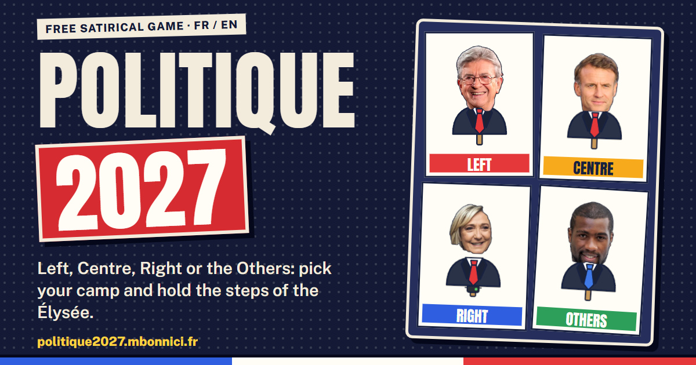
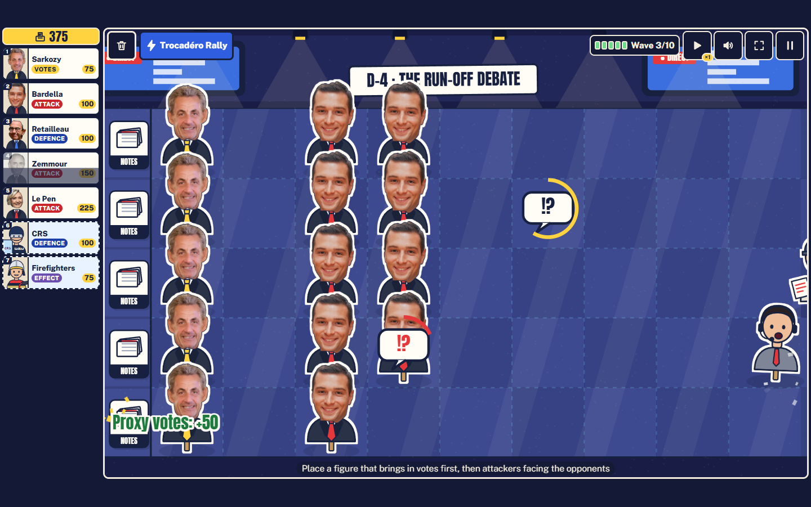
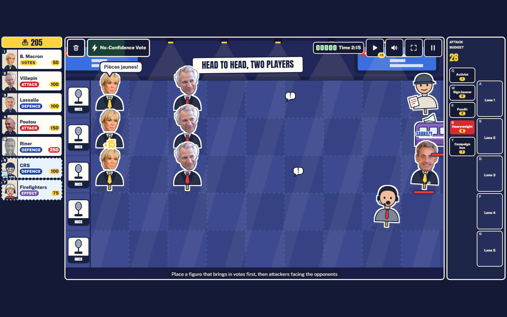
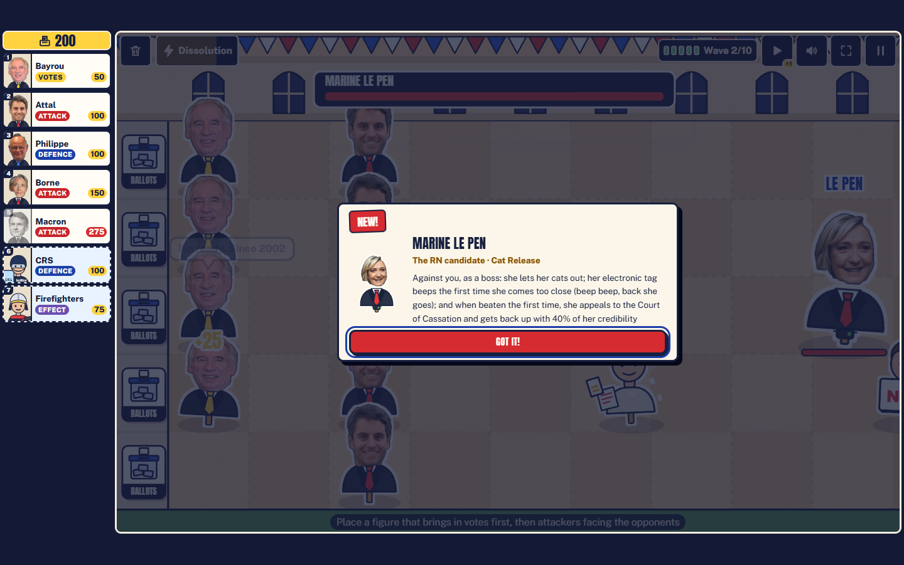
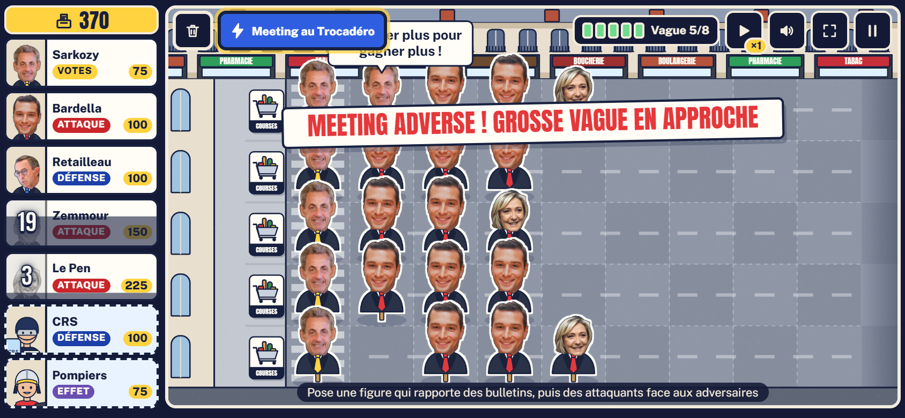
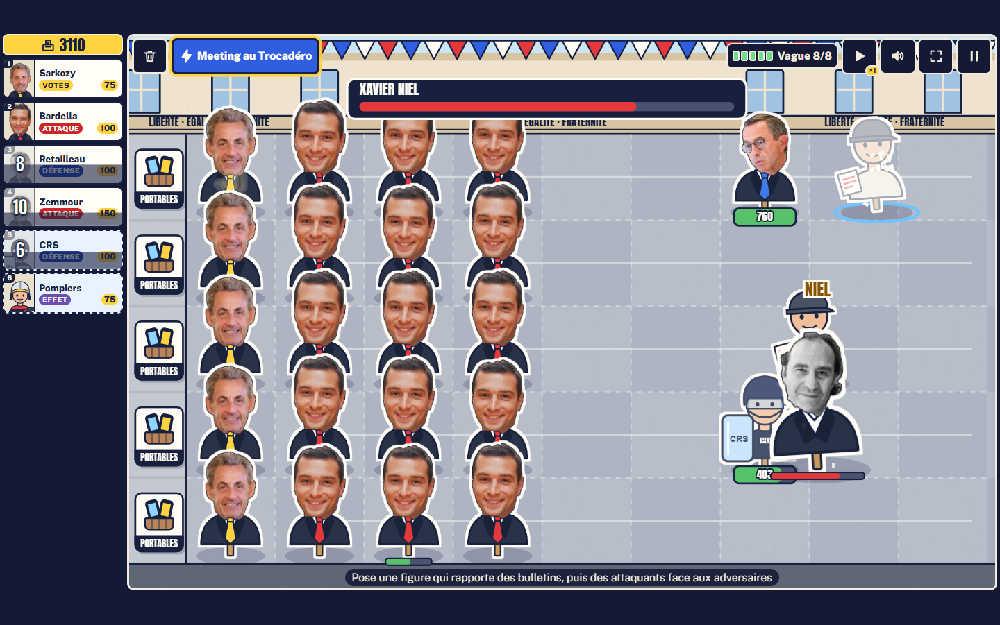
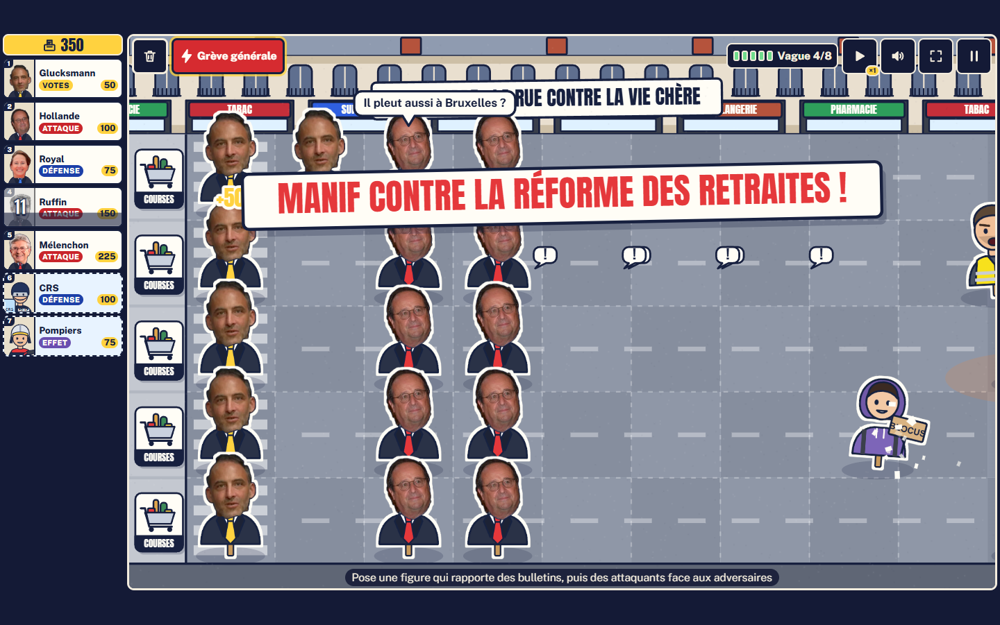
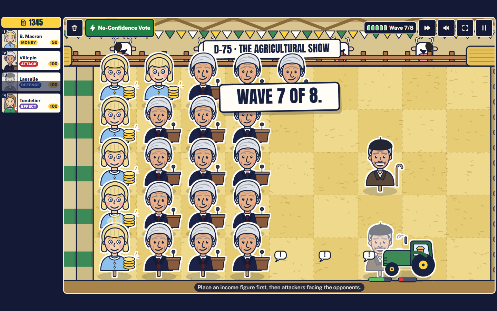
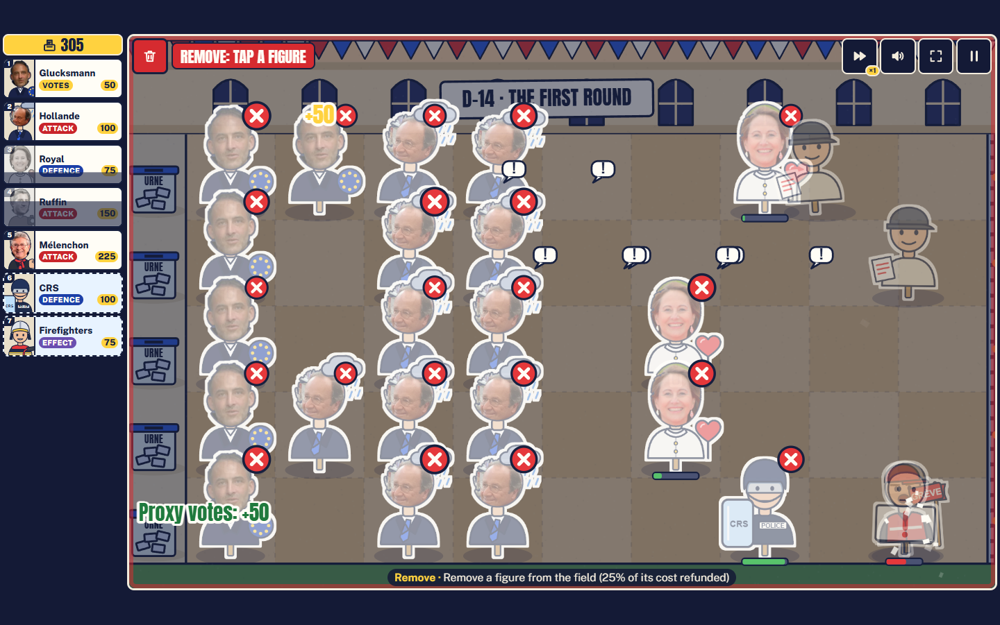
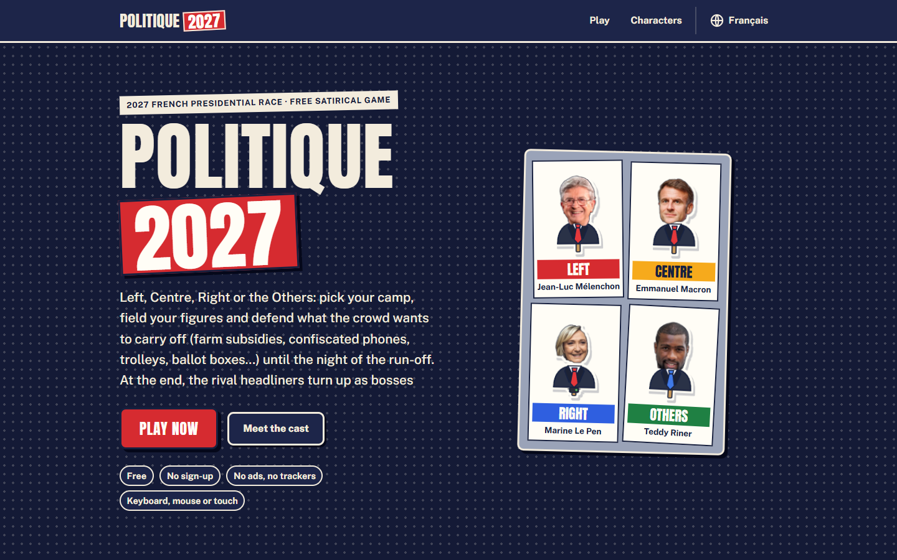

<p align="center">
  <a href="https://politique2027.mbonnici.fr">
    
  </a>
</p>

<h1 align="center">Politique 2027</h1>

<p align="center">
  <strong>The French presidential race, replayed as a lane-defense game — with real faces, French memes and boss fights.</strong><br>
  Pick the Left, the Centre, the Right or the Others. Field 24 public figures, build a deck with turncoats, stack the same figure to level it up — eyes on fire, then the whole figure. Survive nine themed nights and the rival headliners — then play a friend.
</p>

<p align="center">
  <a href="https://politique2027.mbonnici.fr"><strong>▶ Play now — free, in your browser</strong></a><br>
  <sub>Français · English — no sign-up, no ads, no trackers, works offline</sub>
</p>

<p align="center">
  
  
  
  
  
  
  
</p>

---

## Four camps. Zero consensus. Nine crowds that want something.

Every night has a theme and a goal stacked at the end of the lanes: farmers after the **farm subsidies** at the Agricultural Show, pupils after their **confiscated phones** during a school blockade, the **17 October 2026** march against the cost of living after a **full trolley**, pundits after your **speaking time**, everybody after the **ballot boxes** — and, on the run-off night, the **armchair**. You have a column of figures, a stock of **ballots** to pay for them, and five pieces of the goal to keep.

The cast wears **real faces**: freely licensed photos of their heads, cut out like stickers, on cardboard bodies. And the last figure of every camp marches against you as a **boss**, bigger, with powers drawn from French political memes — announced a second before they land, with an angry face:

- **Marine Le Pen** lets her cats out, and when you beat her she **appeals to the Court of Cassation** and gets back up.
- **Emmanuel Macron** _crosses the street_ to dodge your best lane, then calls a **Dissolution**: every figure on 3 × 3 squares goes back to the voters.
- **Jean-Luc Mélenchon** roars _"La République, c'est moi !"_ — every mic in front of him is cut — and sends his **hologram** to hold a rally in another lane.
- **Teddy Riner** throws whoever stands in his way with an **ippon**, and fights harder below half.
- **Xavier Niel** turns up at the school blockade: _"Ping: 999 ms…"_ and three lanes freeze. _"Je t'attends !! T'es où ?!"_
- **Donald Trump** brings his **tariffs** to the summit — 25% on every card, 50% once he is in trouble.

Every camp gets the same affectionate treatment, and all four are playable.

<p align="center">
  
</p>

## Why people keep playing

| | |
|---|---|
| 📸 **Real faces, one body** | 34 photos from Wikimedia Commons (credited in the game and on every figure's page), cut out with a sticker edge, on the same dark suit for everybody — the **tie colour is the card's role**: yellow votes, red attack, purple effect, blue defence. Bosses change face: smiling, angry when they announce an attack, struggling when they are losing. No face is ever retouched — each expression is another real photo. |
| 👑 **Boss fights** | Each camp's headliner is a boss with powers and a health bar: Le Pen, Macron, Mélenchon, Riner — plus Trump and Xavier Niel as guest bosses. A red "!" and flashing squares give you a second to react. |
| 🎭 **24 public figures, 4 play styles** | Six figures per camp (the sixth, unlocked on night 6: Rousseau, Darmanin, Ciotti, Philippot), each card tagged **Votes**, **Attack**, **Effect** or **Defence**, plus a camp-wide trump card: **General Strike**, **Dissolution**, the **Trocadéro Rally** or a **No-Confidence Vote**. |
| 🗓️ **Nine themed nights** | The hunt for endorsements, the Agricultural Show, the school blockade, the 17 October march against the cost of living, the TV debate, the international summit, the first round, the run-off debate (send the soundbites back) and the run-off. Then **Cohabitation**, the endless mode, with a themed week every ten waves. |
| 🎲 **Play a friend** | **Head to head on one screen**: one defends with the mouse or a finger, the other sends opponents with the keyboard or a column of buttons. Or a **turn-based duel**: the same match for two, handed over or shared by link, best score wins. |
| 📅 **Every day, a new challenge** | The **daily challenge** is the same night, camp and waves for everybody. 17 **achievements** to collect (including a 1v1 at the Lidl), a **hard mode** for seasoned players. |
| 🃏 **Build your deck** | From night 6, pick **eight cards** before each night among your figures, seven everyday **reinforcements** unlocked one by one (riot police, firefighters, the speed camera, paramedics, the baker, the teachers, the Constitutional Council) and up to **two turncoats** poached from the rival camps. |
| 🔥 **Level up on the board** | Play a figure on the same figure: at level 2 its eyes catch fire, at level 3 the whole figure does. Tougher, stronger, quicker — and pricier each time. |
| 🗞️ **French life, French memes** | Pupils on electric scooters, the star cow of the Agricultural Show, yellow vests, union marchers who put your figures on strike, minimum-wage workers worth winning over, petrol at €2 a litre, proxy votes refused for a missing document, the Zucman tax vote, a CNews van that never runs out of pundits. |
| 💬 **They talk — to each other too** | Speech bubbles with the cult lines of French politics, in French or English. Neighbours of the same camp answer each other. |
| 🆕 **Never lost** | The first time a boss or a special opponent turns up, the match stops for a short "New!" card that says what it does. The calendar shows each night's goal and who turns up. |
| 📱 **Edge to edge, phone to monitor** | Every landscape screen gets the same layout: a slim column of tickets on the left, the board over the rest of the screen, controls on the scenery. |
| 📲 **Installable, offline** | Add it to the home screen: it opens full screen and plays without a connection — photos included. |
| ⚡ **Instant** | No install, no account. The game is ~72 KB of JavaScript (gzipped) plus ~370 KB of photos; every page is static HTML. Music and sound effects are synthesised. |
| ♿ **Playable by everyone** | Keyboard-only play, screen-reader announcements (boss attacks included, before they land) and a one-key board summary, a slow speed, reduced-motion support, no flashing. |
| 🔒 **Private by design** | Zero cookies, zero analytics, zero third-party requests: even the photos are served from the site. Progress stays in your browser. |

## Ways to play

<table>
  <tr>
    <td width="50%"></td>
    <td width="50%"></td>
  </tr>
  <tr>
    <td align="center"><sub>Night 8: send the soundbites back before they land</sub></td>
    <td align="center"><sub>Head to head: the attacker's column is on the right</sub></td>
  </tr>
  <tr>
    <td></td>
    <td></td>
  </tr>
  <tr>
    <td align="center"><sub>A "New!" card: the boss and its powers</sub></td>
    <td align="center"><sub>On a phone</sub></td>
  </tr>
</table>

| Mode | How it works |
|---|---|
| **Campaign** | Nine themed nights, from the hunt for endorsements to the run-off, unlocked one after the other. Normal or **hard** (every wave 30% bigger). |
| **Cohabitation** | The endless mode, unlocked by finishing the campaign: defend the budget. Every ten waves a themed week starts: CNews, the Zucman tax, a strike, the cost of living, farming, a school blockade. Your record is kept. |
| **Daily challenge** | The same night, camp and waves for everybody on a given day, scored. Your best of the day is on the calendar. |
| **Turn-based duel** | Play a match, then hand over on the same device or share the link (`?duel=…`): the second player plays the exact same match with the score to beat. |
| **Head to head** | Two players, one screen, three minutes. The defender plays as usual; the attacker spends a budget that refills to send activists, sign bearers, pundits, heavyweights or a campaign bus down any lane. |

## Screenshots

<table>
  <tr>
    <td width="50%"></td>
    <td width="50%"></td>
  </tr>
  <tr>
    <td align="center"><sub>The school blockade — and Xavier Niel</sub></td>
    <td align="center"><sub>The street against the cost of living</sub></td>
  </tr>
  <tr>
    <td></td>
    <td></td>
  </tr>
  <tr>
    <td align="center"><sub>The summit — and the tariffs</sub></td>
    <td align="center"><sub>The Agricultural Show</sub></td>
  </tr>
  <tr>
    <td></td>
    <td></td>
  </tr>
  <tr>
    <td align="center"><sub>The big TV debate</sub></td>
    <td align="center"><sub>The hunt for endorsements</sub></td>
  </tr>
  <tr>
    <td></td>
    <td></td>
  </tr>
  <tr>
    <td align="center"><sub>Removing a figure</sub></td>
    <td align="center"><sub>The home page</sub></td>
  </tr>
</table>

## Meet the cast

<p align="center">
  
</p>

| Camp | Line-up (in bold, the boss; last, the night-6 figure) | Campaign trump card |
|---|---|---|
| 🔴 **The Left** — _United… until the next meeting._ | Glucksmann, Hollande, Royal, Ruffin, **Mélenchon**, Rousseau | **General Strike** — every opponent stops dead for 6 seconds. |
| 🟡 **The Centre** — _Neither left nor right. Or both._ | Bayrou, Attal, Philippe, Borne, **Macron**, Darmanin | **Dissolution** — everyone back to the gate… and your ballots drop to zero. |
| 🔵 **The Right** — _Plenty of chiefs for a single chair._ | Sarkozy, Bardella, Retailleau, Zemmour, **Le Pen**, Ciotti | **Trocadéro Rally** — your whole camp speaks twice as fast for 9 seconds. |
| 🟢 **The Others** — _Nobody expected them. They came anyway._ | Brigitte Macron, Villepin, Lassalle, Poutou, **Riner**, Philippot | **No-Confidence Vote** — the three toughest opponents are toppled on the spot. |

Guests: **Donald Trump**, **Xavier Niel**, **HugoDécrypte**, **Élise Lucet** and **Squeezie**. Every anonymous extra has a single look, whichever camp sends it.

The heads are real photos published on Wikimedia Commons under free licences; [`scripts/build-heads.ts`](scripts/build-heads.ts) crops them, separates each head from its background (GrabCut: colour models and a minimum cut) and draws its outline, from the list in [`scripts/heads.json`](scripts/heads.json) (`npm run heads`). Bodies, scenery and extras are original SVG drawn by code ([`portraits.ts`](src/game/render/portraits.ts)); no party, channel or company logo is reproduced. Each named figure and each night also has [a page of its own](https://politique2027.mbonnici.fr/en/characters).

## How it plays

1. **Pick your camp.** The other three become your opponents.
2. **Collect ballots.** Place a figure that brings in votes first.
3. **Defend the goal.** Opponents walk down five lanes towards what they want; each one that gets through carries a piece away. Five pieces, five lives.
4. **Beat the bosses.** Watch for the red "!" — and nobody gets hurt: a figure that runs out of credibility _resigns_ in a burst of confetti, a student _goes back to class_, a fire _goes out_, a CAC 40 boss leaves with a _golden parachute_.

| | Controls |
|---|---|
| **Mouse or touch** | Tap a card, then a square. Long-press a card for its full description. On the debate night, tap a soundbite to send it back. |
| **Keyboard** | `1`–`8` pick a card · arrows aim · `Enter` places (or sends a soundbite back) · `R` removes · `U` trump card · `S` reads a board summary · `F` speed (normal, fast, slow) · `M` sound · `P` / `Esc` pause |
| **Head to head** | The attacker uses the left of the keyboard: top row to choose (`A Z E R T` on AZERTY, `Q W E R T` on QWERTY), home row to send down a lane (`Q S D F G` / `A S D F G`) — or the buttons on the right. |

## Under the hood

| Layer | Choice | Why |
|---|---|---|
| Site | [Astro 7](https://astro.build) (static output, 94 pages) | Pure HTML for crawlers and AI assistants, zero JS on content pages |
| Game | TypeScript + Canvas 2D, no engine | A deterministic simulation that runs headless in tests, ~72 KB gzipped |
| Art | Photo heads (cut out by a script) on procedural SVG puppets, painted stage sets | One drawing routine feeds the site, the canvas, the social cards and this README |
| Audio | Web Audio synth | Sound effects and music without a single audio file, silent until you interact |
| Offline | A service worker, versioned with the game | Opens and plays without a connection; it only ever handles this site's own files |
| Serving | nginx (unprivileged) in Docker | Read-only container, no access log, hashed assets cached for a year |
| Security | Per-page CSP with hashes | No inline script without a hash, no inline style attribute, `frame-ancestors 'none'`, strict headers |
| Tests | Vitest + Playwright + axe-core | 103 simulation tests (bosses, newcomers, decks, levels, damage, saves and balance included), 174 browser tests |

```
src/
├── game/
│   ├── data/          units, camps, levels (numbers only)
│   ├── sim/           engine.ts — the whole match, DOM-free · bot.ts — reference player
│   ├── data/photos.ts which photo heads exist, and their credits (generated)
│   ├── render/        portraits (SVG), goals, scenes (stage sets), sprites, canvas renderer
│   ├── main.ts        screens, HUD, input, game loop
│   ├── modes.ts       daily challenge and duel codes
│   ├── achievements.ts, storage.ts   progress kept on the device
│   └── share.ts, pwa.ts, audio.ts    share picture, home screen and offline, sound
├── i18n/              every string and catchphrase, FR + EN · localised routes
├── lib/               llms.txt, figure and night pages (slugs, social cards)
├── views/             Home, Play, Characters, Figure, Night, Legal
├── styles/            site, game, side layout, game extras
├── legal/             legal notice, privacy, terms, accessibility (Markdown, FR + EN)
└── pages/             the localised routes + sw.js, robots.txt, sitemap.xml, llms.txt
```

## Quick start

Requires Node.js 22.23+ (Node 24 recommended).

```bash
npm install
npm run dev          # http://localhost:4321
```

```bash
npm run build                 # static site in dist/
npm run preview               # serve the production build
npm run check                 # type-check (astro check)
npm test                      # simulation unit tests
npm run test:e2e              # browser tests: accessibility, SEO, keyboard play, layout, modes
npm run balance               # win rate of the reference bot, per night and camp
npm run balance -- 8 hard     # the same in hard mode
npm run heads                 # re-cut the photo heads from Wikimedia Commons (cached in .cache/heads)
npm run heads -- lepen --review   # one figure, plus a review sheet
```

The browser scripts use Playwright. Either run `npx playwright install chromium` once, or reuse an installed browser with `PW_CHANNEL=msedge` (or `chrome`).

```bash
npm run assets       # social card, icons, cast sheet, and one social card per figure (public/og/)
npm run screenshots  # the screenshots above and one picture per night (needs `npm run preview` running)
```

### Balance is tested, not guessed

`npm run balance` plays every night with every camp using a deliberately average bot — one that, on the debate night, sends back three soundbites out of five. The test suite enforces two rules: **the bot must win every night with every camp, and doing nothing must lose.** Change a number in [`units.ts`](src/game/data/units.ts) or [`levels.ts`](src/game/data/levels.ts) and you will know within seconds whether the campaign still holds. Hard mode is meant to beat the bot now and then.

## Deploy

### Docker Compose (local)

```bash
docker compose -f docker-compose.yml -f docker-compose.local.yml up --build
# → http://localhost:8027
```

### Coolify

1. **New resource → Docker Compose**, pointed at this repository (`docker-compose.yml`, base directory `/`).
2. In **Domains**, assign the `web` service: `https://politique2027.mbonnici.fr:8080`  
   (`:8080` is the container port the proxy routes to — visitors still use plain HTTPS).
3. Deploy. The container reports its health on `/healthz`.

No environment variable is needed. No host port is published: traffic goes through the Coolify proxy only. The nginx configuration serves `/sw.js` with `no-cache`, so that every release reaches installed players.

### After a deploy

- [ ] Add the property in [Google Search Console](https://search.google.com/search-console) and submit `https://politique2027.mbonnici.fr/sitemap.xml`
- [ ] Do the same in [Bing Webmaster Tools](https://www.bing.com/webmasters) (it feeds several AI answer engines)
- [ ] Check a social card with a link preview debugger — the home page, a figure page, a night page
- [ ] Confirm `https://politique2027.mbonnici.fr/` redirects to `/fr` or `/en` depending on the browser language
- [ ] On a phone, add the game to the home screen and open it once offline

## SEO, for search engines and for AI

- Static HTML, one `<h1>` per page, canonical URLs, `hreflang` FR/EN/x-default
- **A page per named figure (29) and per night (10)**, in both languages, each with its own social card
- Open Graph and Twitter cards, web manifest, SVG + PNG icons
- JSON-LD: `WebSite`, `VideoGame`, `FAQPage`, `BreadcrumbList`, `ItemList`, `CreativeWork`
- [`/sitemap.xml`](src/pages/sitemap.xml.ts) with per-URL language alternates
- [`/robots.txt`](src/pages/robots.txt.ts) that explicitly welcomes AI crawlers
- [`/llms.txt`](src/lib/llms.ts) and `/llms-full.txt`, generated from the same data as the pages

## Accessibility

Self-assessed as **partially compliant** with RGAA 4.1.2 / WCAG 2.2 AA. axe-core reports no violation on any page, nor on the game screens, and Lighthouse scores 100 for accessibility. The game can be played with the keyboard alone, a slow speed is available, `S` reads a summary of the board and every event is announced — boss attacks while they are still being prepared. The real-time canvas is the honest limit: screen-reader users get summaries and live announcements, not a full equivalent. Landscape is the default on phones and can be released from the pause menu. Details in the [accessibility statement](https://politique2027.mbonnici.fr/en/accessibility).

## Privacy

No cookie, no analytics, no third-party request — the photos are served from the site, not from Wikimedia. Progress, settings, daily scores and achievements are kept in the browser's `localStorage`; the offline copy of the site lives in its cache. A duel link only holds the night, the camp, the match's draw and a score. The share button hands a picture to the system share sheet — nothing leaves the device unless you send it. Details in the [privacy policy](https://politique2027.mbonnici.fr/en/privacy-policy).

## Versioning

Versions follow `MAJOR.MEDIUM.MINOR` — see the [changelog](CHANGELOG.md).

## Satire notice

Politique 2027 is a work of satire and parody. The characters are caricatures of public figures: real photos of their heads on drawn bodies, which are obviously montages. No face is retouched; an angry or worried face is another real photo. Their powers and the situations are made up for laughs and do not describe facts or reflect the author's opinions. Where a power nods to a public fact (Marine Le Pen's conviction on appeal of 7 July 2026 and her announced appeal to the Court of Cassation; Jean-Luc Mélenchon's 2017 hologram rallies; Xavier Niel's public "1v1" exchange of November 2024), the legal notice says so. Some speech bubbles are famous public catchphrases, quoted as such; the others are invented. The 17 October night refers to that day of protests without targeting any organiser or participant; other news twists are generic. One guest only appears against the Right because he publicly took a stand against the far right in 2024: that reflects his stance, not a bias of the game. The game is not affiliated with any party, candidate, company, media outlet or institution, and is neither a poll nor a call to vote.

It is an original game in the lane-defense genre and reuses no name, character, artwork, music or level from any existing game.

## Licence

Code, texts and drawings: [MIT](LICENSE) © 2026 [Maxence Bonnici](https://mbonnici.fr).

The photo heads in [`public/heads/`](public/heads) are **not** MIT: each one keeps the free licence of its source photo on Wikimedia Commons (CC BY, CC BY-SA, CC0, public domain, Licence Ouverte or free reuse with attribution) — authors, licences and links are in [`scripts/heads.json`](scripts/heads.json), on [the legal notice](https://politique2027.mbonnici.fr/en/legal-notice) and on each figure's page.
