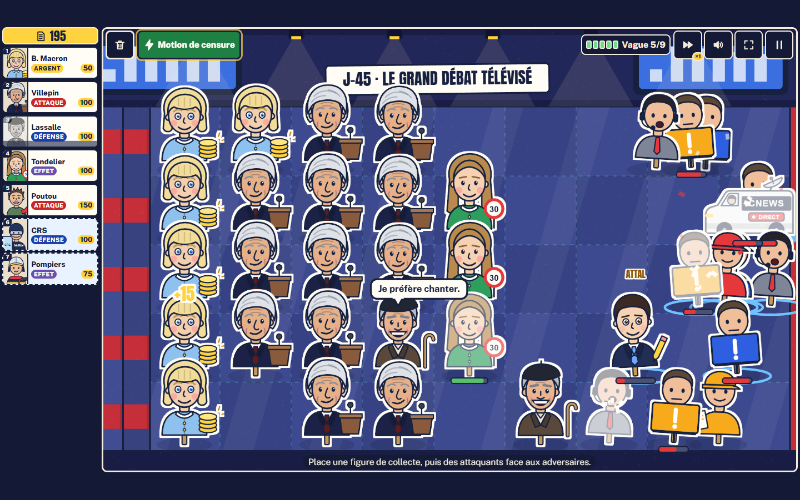
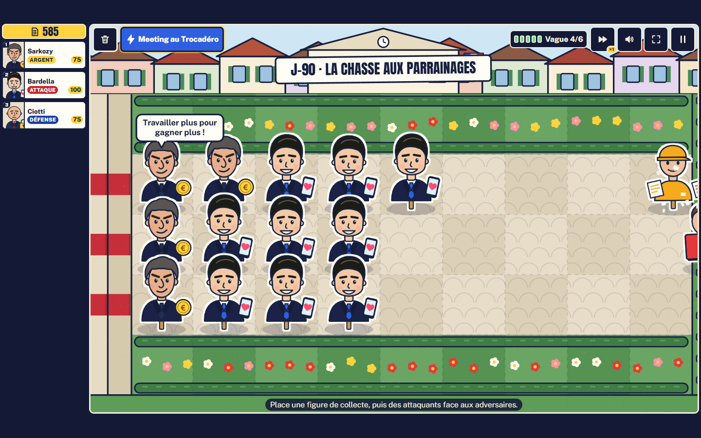

<p align="center">
  <a href="https://politique2027.mbonnici.fr">
    
  </a>
</p>

<h1 align="center">Politique 2027</h1>

<p align="center">
  <strong>The French presidential race, replayed as a paper-puppet lane-defense game.</strong><br>
  Pick the Left, the Centre, the Right or the Others. Field 28 caricatures. Survive eight campaign nights — then play a friend.
</p>

<p align="center">
  <a href="https://politique2027.mbonnici.fr"><strong>▶ Play now — free, in your browser</strong></a><br>
  <sub>Français · English — no sign-up, no ads, no trackers, works offline</sub>
</p>

<p align="center">
  
  
  
  
  
  
  
</p>

---

## Four camps. Zero consensus. One front door.

Rivals pour in by waves. You have a courtyard, a handful of endorsements and a cast of public figures whose powers — and speech bubbles — come straight from their most famous one-liners.

- **Macron** fires down three lanes _"en même temps"_ and shrugs: _"De la poudre de perlimpinpin !"_
- **Mélenchon** roars _"La République, c'est moi !"_ and the whole lane steps back.
- **Le Pen**, certified cat breeder, releases the cats: _"Ils sont là, dans les campagnes…"_
- **Borne** passes the whole lane with a **49.3**. Her substitute, **Lecornu**, refuses to: the lane stops to _negotiate_.
- **Teddy Riner**, neither left nor right, answers anyone who comes close with an **ippon**.
- **Élise Lucet** walks straight past your defenders to question the ones who bring in the money. _"No comment!"_
- **Trump** drops by the summit with his **tariffs**: while he stands there, every card costs 25% more.

Every camp gets the same affectionate treatment, and all four are playable.

<p align="center">
  
</p>

## Why people keep playing

| | |
|---|---|
| 🎭 **28 headliners, 4 play styles** | Six figures per camp and a substitute (Cazeneuve, Lecornu, Bertrand, Arthaud), each card tagged **Money**, **Attack**, **Effect** or **Defence**, plus a camp-wide trump card: **General Strike**, **Dissolution**, the **Trocadéro Rally** or a **No-Confidence Vote**. |
| 🎬 **Eight nights, six stage sets** | A village square, the Agricultural Show, the street, a TV studio, an international summit, **the run-off debate** — tap the soundbites before they land to send them back — and the Élysée by dusk and by night. Then **Cohabitation**, the endless mode, with a themed week every ten waves. |
| 🎲 **Play a friend** | **Head to head on one screen**: one defends with the mouse or a finger, the other sends opponents with the keyboard or a column of buttons. Or a **turn-based duel**: the same match for two, handed over or shared by link, best score wins. |
| 📅 **Every day, a new challenge** | The **daily challenge** is the same night, camp and waves for everybody. 14 **achievements** to collect, a **hard mode** for seasoned players. |
| 🗞️ **Ripped from the headlines** | School blockades, union marches that put your figures on strike, minimum-wage workers worth winning over, a march against the pension reform, a rival 49.3, yellow vests, burning bins, motorists paying €2 a litre, farmers and their tractors, CAC 40 bosses (and a Zucman tax vote that sends them into exile), a CNews broadcast van that never runs out of pundits — all as generic, harmless twists. |
| 🎟️ **Guests** | Donald Trump and his tariffs, HugoDécrypte with one question for everybody, Élise Lucet who follows the money, Squeezie and his story, Sylvain Durif with his pan flute and David Lisnard, who rolls out the red carpet. |
| 💬 **They talk — to each other too** | Speech bubbles with the cult lines of French politics, in French or English. Neighbours of the same camp answer each other. |
| 🆕 **Never lost** | The first time a special opponent turns up, the match stops for a short "New!" card. The calendar lists who turns up each night; a long press on a card shows its full description. |
| 📱 **Edge to edge, phone to monitor** | Every landscape screen gets the same layout: a slim column of tickets on the left, the board over the rest of the screen, controls on the scenery. The scenery is cropped or widened to fit, so the board always reaches the edges and the puppets get as big as the screen allows. |
| 📲 **Installable, offline** | Add it to the home screen: it opens full screen, uses the whole width of a notched phone, and plays without a connection. |
| 📤 **Share the front page** | The end-of-match gazette becomes a picture for the system share sheet — duels come with their link. Nothing is sent unless you send it. |
| ⚡ **Instant** | No install, no account. The whole game is ~65 KB of JavaScript (gzipped); every page is static HTML. Background music and sound effects are synthesised: no audio file to download. |
| ♿ **Playable by everyone** | Keyboard-only play, screen-reader announcements and a one-key board summary, a slow speed, reduced-motion support, no flashing. |
| 🔒 **Private by design** | Zero cookies, zero analytics, zero third-party requests. Progress stays in your browser. |

## Ways to play

<table>
  <tr>
    <td width="50%"></td>
    <td width="50%"></td>
  </tr>
  <tr>
    <td align="center"><sub>Night 7: send the soundbites back before they land</sub></td>
    <td align="center"><sub>Head to head: the attacker's column is on the right</sub></td>
  </tr>
  <tr>
    <td></td>
    <td></td>
  </tr>
  <tr>
    <td align="center"><sub>A "New!" card: the match waits</sub></td>
    <td align="center"><sub>On a phone</sub></td>
  </tr>
</table>

| Mode | How it works |
|---|---|
| **Campaign** | Eight nights, from the hunt for endorsements to the run-off, unlocked one after the other. Normal or **hard** (every wave 30% bigger). Field a camp's **substitute** from the calendar. |
| **Cohabitation** | The endless mode, unlocked by finishing the campaign. Every ten waves a themed week starts: CNews, the Zucman tax, a strike, the cost of living, farming. Your record is kept. |
| **Daily challenge** | The same night, camp and waves for everybody on a given day, scored. Your best of the day is on the calendar. |
| **Turn-based duel** | Play a match, then hand over on the same device or share the link (`?duel=…`): the second player plays the exact same match with the score to beat. |
| **Head to head** | Two players, one screen, three minutes. The defender plays as usual; the attacker spends a budget that refills to send activists, sign bearers, pundits, heavyweights or a campaign bus down any lane. |

## Screenshots

<table>
  <tr>
    <td width="50%"></td>
    <td width="50%"></td>
  </tr>
  <tr>
    <td align="center"><sub>The street rumbles</sub></td>
    <td align="center"><sub>The summit — and the tariffs</sub></td>
  </tr>
  <tr>
    <td></td>
    <td></td>
  </tr>
  <tr>
    <td align="center"><sub>The big TV debate</sub></td>
    <td align="center"><sub>The Agricultural Show</sub></td>
  </tr>
  <tr>
    <td></td>
    <td></td>
  </tr>
  <tr>
    <td align="center"><sub>The hunt for endorsements</sub></td>
    <td align="center"><sub>Pick your camp</sub></td>
  </tr>
  <tr>
    <td></td>
    <td></td>
  </tr>
  <tr>
    <td align="center"><sub>Removing a figure</sub></td>
    <td align="center"><sub>The home page</sub></td>
  </tr>
</table>

## Meet the cast

<p align="center">
  
</p>

| Camp | Motto | Campaign trump card | Substitute |
|---|---|---|---|
| 🔴 **The Left** | _United… until the next meeting._ | **General Strike** — every opponent stops dead for 6 seconds. | **Bernard Cazeneuve** for Hollande — _The Method_: one sentence through two opponents. |
| 🟡 **The Centre** | _Neither left nor right. Or both._ | **Dissolution** — everyone back to the gate… and your chest drops to zero. | **Sébastien Lecornu** for Borne — _No 49.3_: the whole lane stops to negotiate. |
| 🔵 **The Right** | _Plenty of chiefs for a single chair._ | **Trocadéro Rally** — your whole camp speaks twice as fast for 9 seconds. | **Xavier Bertrand** for Ciotti — _Fully Comprehensive_: neighbours take 30% less. |
| 🟢 **The Others** | _Nobody expected them. They came anyway._ | **No-Confidence Vote** — the three toughest opponents are toppled on the spot. | **Nathalie Arthaud** for Poutou — _"Working women, working men!"_ down the whole lane. |

Every puppet is an original SVG drawing generated by code ([`portraits.ts`](src/game/render/portraits.ts)): no photo, no party logo, no channel logo, no third-party asset. Each named figure and each night also has [a page of its own](https://politique2027.mbonnici.fr/en/characters).

## How it plays

1. **Pick your camp.** The other three become your opponents.
2. **Collect endorsements.** A nod to the 500 signatures every French candidate needs. Place an income figure first.
3. **Hold the steps.** Opponents walk down five lanes. Each one that reaches the steps costs you a poll point.
4. **Survive every wave** to win the night — and nobody gets hurt: a figure that runs out of credibility _resigns_ in a burst of confetti, a student _goes back to class_, a fire _goes out_, a CAC 40 boss leaves with a _golden parachute_.

| | Controls |
|---|---|
| **Mouse or touch** | Tap a card, then a square. Long-press a card for its full description. On the debate night, tap a soundbite to send it back. |
| **Keyboard** | `1`–`8` pick a figure · arrows aim · `Enter` places (or sends a soundbite back) · `R` removes · `U` trump card · `S` reads a board summary · `F` speed (normal, fast, slow) · `M` sound · `P` / `Esc` pause |
| **Head to head** | The attacker uses the left of the keyboard: top row to choose (`A Z E R T` on AZERTY, `Q W E R T` on QWERTY), home row to send down a lane (`Q S D F G` / `A S D F G`) — or the buttons on the right. |

## Under the hood

| Layer | Choice | Why |
|---|---|---|
| Site | [Astro 7](https://astro.build) (static output, 102 pages) | Pure HTML for crawlers and AI assistants, zero JS on content pages |
| Game | TypeScript + Canvas 2D, no engine | A deterministic simulation that runs headless in tests, ~65 KB gzipped |
| Art | Procedural SVG puppets and painted stage sets | One drawing routine feeds the site, the canvas, the social cards and this README |
| Audio | Web Audio synth | Sound effects and music without a single audio file, silent until you interact |
| Offline | A service worker, versioned with the game | Opens and plays without a connection; it only ever handles this site's own files |
| Serving | nginx (unprivileged) in Docker | Read-only container, no access log, hashed assets cached for a year |
| Security | Per-page CSP with hashes | No inline script without a hash, no inline style attribute, `frame-ancestors 'none'`, strict headers |
| Tests | Vitest + Playwright + axe-core | 81 simulation tests, 168 browser tests |

```
src/
├── game/
│   ├── data/          units, camps, levels (numbers only)
│   ├── sim/           engine.ts — the whole match, DOM-free · bot.ts — reference player
│   ├── render/        portraits (SVG), scenes (stage sets), sprites, canvas renderer
│   ├── main.ts        screens, HUD, input, game loop
│   ├── modes.ts       daily challenge and duel codes
│   ├── achievements.ts, storage.ts   progress kept on the device
│   └── share.ts, pwa.ts, audio.ts    share picture, home screen and offline, sound
├── i18n/              every string and catchphrase, FR + EN · localised routes
├── lib/               llms.txt, figure and night pages (slugs, social cards)
├── views/             Home, Play, Characters, Figure, Night, Legal
├── styles/            site, game, side layout, game extras
├── legal/             legal notice, privacy, terms, accessibility (Markdown, FR + EN)
└── pages/             the localised routes + sw.js, robots.txt, sitemap.xml, llms.txt
```

## Quick start

Requires Node.js 22.23+ (Node 24 recommended).

```bash
npm install
npm run dev          # http://localhost:4321
```

```bash
npm run build                 # static site in dist/
npm run preview               # serve the production build
npm run check                 # type-check (astro check)
npm test                      # simulation unit tests
npm run test:e2e              # browser tests: accessibility, SEO, keyboard play, layout, modes
npm run balance               # win rate of the reference bot, per night and camp
npm run balance -- 8 hard     # the same in hard mode
```

The browser scripts use Playwright. Either run `npx playwright install chromium` once, or reuse an installed browser with `PW_CHANNEL=msedge` (or `chrome`).

```bash
npm run assets       # social card, icons, cast sheet, and one social card per figure (public/og/)
npm run screenshots  # the screenshots above and one picture per night (needs `npm run preview` running)
```

### Balance is tested, not guessed

`npm run balance` plays every night with every camp using a deliberately average bot — one that, on the debate night, sends back three soundbites out of five. The test suite enforces two rules: **the bot must win every night with every camp, and doing nothing must lose.** Change a number in [`units.ts`](src/game/data/units.ts) or [`levels.ts`](src/game/data/levels.ts) and you will know within seconds whether the campaign still holds. Hard mode is meant to beat the bot now and then.

## Deploy

### Docker Compose (local)

```bash
docker compose -f docker-compose.yml -f docker-compose.local.yml up --build
# → http://localhost:8027
```

### Coolify

1. **New resource → Docker Compose**, pointed at this repository (`docker-compose.yml`, base directory `/`).
2. In **Domains**, assign the `web` service: `https://politique2027.mbonnici.fr:8080`  
   (`:8080` is the container port the proxy routes to — visitors still use plain HTTPS).
3. Deploy. The container reports its health on `/healthz`.

No environment variable is needed. No host port is published: traffic goes through the Coolify proxy only. The nginx configuration serves `/sw.js` with `no-cache`, so that every release reaches installed players.

### After a deploy

- [ ] Add the property in [Google Search Console](https://search.google.com/search-console) and submit `https://politique2027.mbonnici.fr/sitemap.xml`
- [ ] Do the same in [Bing Webmaster Tools](https://www.bing.com/webmasters) (it feeds several AI answer engines)
- [ ] Check a social card with a link preview debugger — the home page, a figure page, a night page
- [ ] Confirm `https://politique2027.mbonnici.fr/` redirects to `/fr` or `/en` depending on the browser language
- [ ] On a phone, add the game to the home screen and open it once offline

## SEO, for search engines and for AI

- Static HTML, one `<h1>` per page, canonical URLs, `hreflang` FR/EN/x-default
- **A page per named figure (34) and per night (9)**, in both languages, each with its own social card
- Open Graph and Twitter cards, web manifest, SVG + PNG icons
- JSON-LD: `WebSite`, `VideoGame`, `FAQPage`, `BreadcrumbList`, `ItemList`, `CreativeWork`
- [`/sitemap.xml`](src/pages/sitemap.xml.ts) with per-URL language alternates
- [`/robots.txt`](src/pages/robots.txt.ts) that explicitly welcomes AI crawlers
- [`/llms.txt`](src/lib/llms.ts) and `/llms-full.txt`, generated from the same data as the pages

## Accessibility

Self-assessed as **partially compliant** with RGAA 4.1.2 / WCAG 2.2 AA. axe-core reports no violation on any page, nor on the game screens, and Lighthouse scores 100 for accessibility. The game can be played with the keyboard alone, a slow speed is available, `S` reads a summary of the board and every event is announced. The real-time canvas is the honest limit: screen-reader users get summaries and live announcements, not a full equivalent. Landscape is the default on phones and can be released from the pause menu. Details in the [accessibility statement](https://politique2027.mbonnici.fr/en/accessibility).

## Privacy

No cookie, no analytics, no third-party request. Progress, settings, daily scores and achievements are kept in the browser's `localStorage`; the offline copy of the site lives in its cache. A duel link only holds the night, the camp, the match's draw and a score. The share button hands a picture to the system share sheet — nothing leaves the device unless you send it. Details in the [privacy policy](https://politique2027.mbonnici.fr/en/privacy-policy).

## Versioning

Versions follow `MAJOR.MEDIUM.MINOR` — see the [changelog](CHANGELOG.md).

## Satire notice

Politique 2027 is a work of satire and parody. The characters are caricatures of public figures; their powers and the situations are made up for laughs and do not describe facts or reflect the author's opinions. Some speech bubbles are famous public catchphrases, quoted as such; the others are invented. Street events and news twists are generic and refer to no specific place, date or person. One guest only appears against the Right because he publicly took a stand against the far right in 2024: that reflects his stance, not a bias of the game. The journalist and the rolling-news channel turn up against every camp alike. The game is not affiliated with any party, candidate, media outlet or institution, and is neither a poll nor a call to vote.

It is an original game in the lane-defense genre and reuses no name, character, artwork, music or level from any existing game.

## Licence

[MIT](LICENSE) © 2026 [Maxence Bonnici](https://mbonnici.fr)
