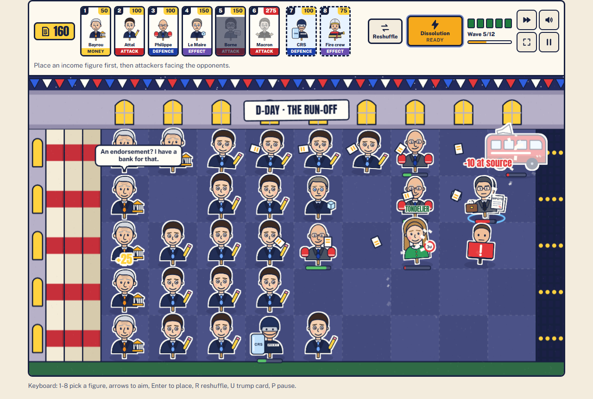
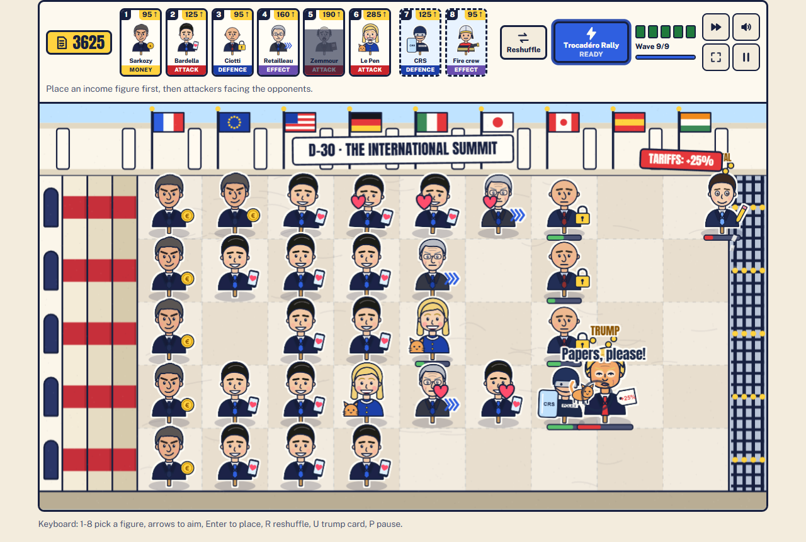
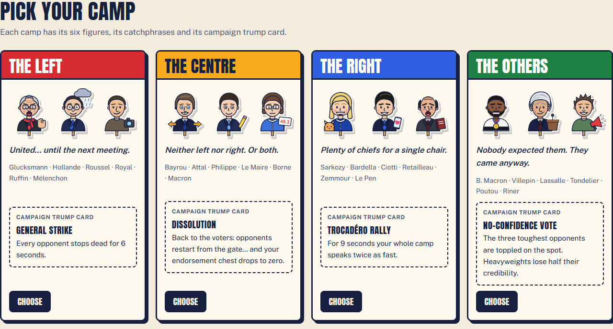
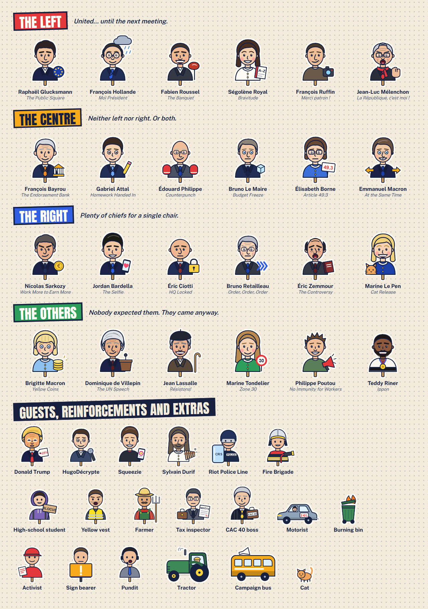

<p align="center">
  <a href="https://politique2027.mbonnici.fr">
    
  </a>
</p>

<h1 align="center">Politique 2027</h1>

<p align="center">
  <strong>The French presidential race, replayed as a paper-puppet lane-defense game.</strong><br>
  Pick the Left, the Centre, the Right or the Others. Field 24 caricatures. Hold the steps of the Élysée until election night.
</p>

<p align="center">
  <a href="https://politique2027.mbonnici.fr"><strong>▶ Play now — free, in your browser</strong></a><br>
  <sub>Français · English — no sign-up, no ads, no trackers</sub>
</p>

<p align="center">
  
  
  
  
  
  
</p>

---

## Four camps. Zero consensus. One front door.

Rivals pour in by waves. You have a courtyard, a handful of endorsements and a cast of public figures whose powers — and speech bubbles — come straight from their most famous one-liners.

- **Macron** fires down three lanes _"en même temps"_ and shrugs: _"De la poudre de perlimpinpin !"_
- **Mélenchon** roars _"La République, c'est moi !"_ and the whole lane steps back.
- **Le Pen**, certified cat breeder, releases the cats: _"Ils sont là, dans les campagnes…"_
- **Teddy Riner**, neither left nor right, answers anyone who comes close with an **ippon**.
- **Hollande** fires anaphoras in bursts of three and signs off _"Friendly, François."_ It is raining, as usual.
- **Trump** drops by the summit with his **tariffs**: while he stands there, every card costs 25% more.

Every camp gets the same affectionate treatment, and all four are playable.

<p align="center">
  
</p>

## Why people keep playing

| | |
|---|---|
| 🎭 **24 headliners, 4 play styles** | Six figures per camp, each card tagged **Money**, **Attack**, **Effect** or **Defence**, plus a camp-wide trump card: **General Strike**, **Dissolution**, the **Trocadéro Rally** or a **No-Confidence Vote**. |
| 💬 **They talk** | Speech bubbles with the cult lines of French politics, in French or English. |
| 🗞️ **Ripped from the headlines** | School blockades, yellow vests, burning bins, motorists paying €2 a litre, farmers and their tractors, CAC 40 bosses, a tax inspector who withholds at source, benefit transfers that arrive when the file is complete — all as generic, harmless twists. Riot police and firefighters are reinforcements every camp can call. |
| 🎟️ **Guests** | Donald Trump and his tariffs, HugoDécrypte with one question for everybody, Squeezie and his story, and Sylvain Durif with his pan flute. |
| 🎬 **Seven nights, six stage sets** | A village square, the Agricultural Show, the street, a TV studio, an international summit and the Élysée by dusk and by night. Then **Cohabitation**, the endless mode. |
| ⚡ **Instant** | No install, no account. The whole game is ~45 KB of JavaScript (gzipped); every page is static HTML. |
| 📱 **Everywhere** | Desktop, tablet and phone. On a phone the match is landscape and fullscreen, cards in a column on the left, like the genre's mobile classics — and where the browser cannot lock the screen, the game draws itself sideways. |
| ♿ **Playable by everyone** | Keyboard-only play, screen-reader announcements, reduced-motion support, no flashing. |
| 🔒 **Private by design** | Zero cookies, zero analytics, zero third-party requests. Progress stays in your browser. |

<table>
  <tr>
    <td width="50%"></td>
    <td width="50%"></td>
  </tr>
  <tr>
    <td align="center"><sub>The street rumbles</sub></td>
    <td align="center"><sub>The summit — and the tariffs</sub></td>
  </tr>
  <tr>
    <td></td>
    <td></td>
  </tr>
  <tr>
    <td align="center"><sub>The big TV debate</sub></td>
    <td align="center"><sub>The Agricultural Show</sub></td>
  </tr>
  <tr>
    <td></td>
    <td></td>
  </tr>
  <tr>
    <td align="center"><sub>The hunt for endorsements</sub></td>
    <td align="center"><sub>Pick your camp</sub></td>
  </tr>
</table>

## Meet the cast

<p align="center">
  
</p>

| Camp | Motto | Campaign trump card |
|---|---|---|
| 🔴 **The Left** | _United… until the next meeting._ | **General Strike** — every opponent stops dead for 6 seconds. |
| 🟡 **The Centre** | _Neither left nor right. Or both._ | **Dissolution** — everyone back to the gate… and your chest drops to zero. |
| 🔵 **The Right** | _Plenty of chiefs for a single chair._ | **Trocadéro Rally** — your whole camp speaks twice as fast for 9 seconds. |
| 🟢 **The Others** | _Nobody expected them. They came anyway._ | **No-Confidence Vote** — the three toughest opponents are toppled on the spot. |

Every puppet is an original SVG drawing generated by code ([`portraits.ts`](src/game/render/portraits.ts)): no photo, no party logo, no third-party asset.

## How it plays

1. **Pick your camp.** The other three become your opponents.
2. **Collect endorsements.** A nod to the 500 signatures every French candidate needs. Place an income figure first.
3. **Hold the steps.** Opponents walk down five lanes. Each one that reaches the steps costs you a poll point.
4. **Survive every wave** to win the night — and nobody gets hurt: a figure that runs out of credibility _resigns_ in a burst of confetti, a student _goes back to class_, a fire _goes out_.

Mouse or touch: click a card, click a square. Keyboard: `1`–`8` pick a figure, arrows aim, `Enter` places, `R` reshuffles, `U` fires the trump card, `P` pauses.

## Under the hood

| Layer | Choice | Why |
|---|---|---|
| Site | [Astro 7](https://astro.build) (static output) | Pure HTML for crawlers and AI assistants, zero JS on content pages |
| Game | TypeScript + Canvas 2D, no engine | A deterministic simulation that runs headless in tests, ~45 KB gzipped |
| Art | Procedural SVG puppets and painted stage sets | One drawing routine feeds the site, the canvas, the social card and this README |
| Audio | Web Audio synth | No audio file to download, silent until you interact |
| Serving | nginx (unprivileged) in Docker | Read-only container, no access log, hashed assets cached for a year |
| Security | Per-page CSP with hashes | No inline script without a hash, `frame-ancestors 'none'`, strict headers |
| Tests | Vitest + Playwright + axe-core | 61 simulation tests, 144 browser tests |

```
src/
├── game/
│   ├── data/      units, camps, levels (numbers only)
│   ├── sim/       engine.ts — the whole match, DOM-free · bot.ts — reference player
│   ├── render/    portraits (SVG), scenes (stage sets), sprites, canvas renderer
│   └── main.ts    screens, HUD, input, game loop
├── i18n/          every string and catchphrase, FR + EN · localised routes
├── views/         Home, Play, Characters, Legal
├── legal/         legal notice, privacy, terms, accessibility (Markdown, FR + EN)
└── pages/         one dynamic route + robots.txt, sitemap.xml, llms.txt
```

## Quick start

Requires Node.js 22.23+ (Node 24 recommended).

```bash
npm install
npm run dev          # http://localhost:4321
```

```bash
npm run build        # static site in dist/
npm run preview      # serve the production build
npm run check        # type-check (astro check)
npm test             # simulation unit tests
npm run test:e2e     # browser tests: accessibility, SEO, keyboard play, layout
npm run balance      # win rate of the reference bot, per level and camp
```

The browser scripts use Playwright. Either run `npx playwright install chromium` once, or reuse an installed browser with `PW_CHANNEL=msedge` (or `chrome`).

```bash
npm run assets       # regenerate the social card, icons and cast sheet
npm run screenshots  # regenerate the screenshots above (needs `npm run preview` running)
```

### Balance is tested, not guessed

`npm run balance` plays every level with every camp using a deliberately average bot. The test suite enforces two rules: **the bot must win every level with every camp, and doing nothing must lose.** Change a number in [`units.ts`](src/game/data/units.ts) or [`levels.ts`](src/game/data/levels.ts) and you will know within seconds whether the campaign still holds.

## Deploy

### Docker Compose (local)

```bash
docker compose -f docker-compose.yml -f docker-compose.local.yml up --build
# → http://localhost:8027
```

### Coolify

1. **New resource → Docker Compose**, pointed at this repository (`docker-compose.yml`, base directory `/`).
2. In **Domains**, assign the `web` service: `https://politique2027.mbonnici.fr:8080`  
   (`:8080` is the container port the proxy routes to — visitors still use plain HTTPS).
3. Deploy. The container reports its health on `/healthz`.

No environment variable is needed. No host port is published: traffic goes through the Coolify proxy only.

### After the first deploy

- [ ] Add the property in [Google Search Console](https://search.google.com/search-console) and submit `https://politique2027.mbonnici.fr/sitemap.xml`
- [ ] Do the same in [Bing Webmaster Tools](https://www.bing.com/webmasters) (it feeds several AI answer engines)
- [ ] Check the social card with a link preview debugger
- [ ] Confirm `https://politique2027.mbonnici.fr/` redirects to `/fr` or `/en` depending on the browser language

## SEO, for search engines and for AI

- Static HTML, one `<h1>` per page, canonical URLs, `hreflang` FR/EN/x-default
- Open Graph and Twitter cards, web manifest, SVG + PNG icons
- JSON-LD: `WebSite`, `VideoGame`, `FAQPage`, `BreadcrumbList`, `ItemList`
- [`/sitemap.xml`](src/pages/sitemap.xml.ts) with per-URL language alternates
- [`/robots.txt`](src/pages/robots.txt.ts) that explicitly welcomes AI crawlers
- [`/llms.txt`](src/lib/llms.ts) and `/llms-full.txt`, generated from the same data as the pages

## Accessibility

Self-assessed as **partially compliant** with RGAA 4.1.2 / WCAG 2.2 AA. axe-core reports no violation on any page, in either theme, nor on the game screens. The real-time canvas is the honest limit: screen-reader users get lane summaries and live announcements, not a full equivalent. Landscape is the default on phones and can be released from the pause menu. Details in the [accessibility statement](https://politique2027.mbonnici.fr/en/accessibility).

## Versioning

Versions follow `MAJOR.MEDIUM.MINOR` — see the [changelog](CHANGELOG.md).

## Satire notice

Politique 2027 is a work of satire and parody. The characters are caricatures of public figures; their powers and the situations are made up for laughs and do not describe facts or reflect the author's opinions. Some speech bubbles are famous public catchphrases, quoted as such; the others are invented. Street events are generic and refer to no specific place, date or person. One guest only appears against the Right because he publicly took a stand against the far right in 2024: that reflects his stance, not a bias of the game. The game is not affiliated with any party, candidate or institution, and is neither a poll nor a call to vote.

It is an original game in the lane-defense genre and reuses no name, character, artwork, music or level from any existing game.

## Licence

[MIT](LICENSE) © 2026 [Maxence Bonnici](https://mbonnici.fr)
